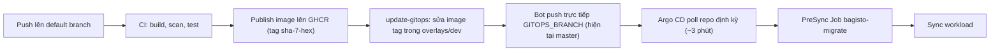

# Kiến trúc GitOps

Tài liệu này mô tả luồng triển khai hiện có của Bagisto trên Argo CD và các quy ước đang áp dụng. Mọi giá trị đều lấy từ manifest trong repo hoặc trạng thái chỉ đọc của cluster; phần chưa xác minh được liệt kê riêng ở cuối.

## 1. Luồng tổng quát

- CI build/scan/test chạy cho push và pull request; job `publish` và `update-gitops` chỉ chạy khi push lên default branch của repo source.
- Bot hiện commit và push trực tiếp vào `GITOPS_BRANCH`; chưa mở PR. Chính sách chuyển sang PR được ghi ở [ADR 0001](adr/0001-repo-layout-and-conventions.md).
- Argo CD tự poll repo. Cluster hiện không đặt `timeout.reconciliation` trong `argocd-cm`; giá trị poll thực tế chưa được đo.

## 2. Sync wave và hook hiện có

Không có annotation `argocd.argoproj.io/sync-wave` trong `base/` hoặc `overlays/dev/`. Vì vậy mọi tài nguyên dưới đây dùng wave mặc định, trừ Job `bagisto-migrate` là hook `PreSync`.

| Tài nguyên | Kind | Sync wave | Hook | Ghi chú |
|---|---|---|---|---|
| `bagisto` | Namespace | Mặc định | Không | Cluster resource, nằm trong `clusterResourceWhitelist`. |
| `bagisto-config` | ConfigMap | Mặc định | Không | Cấu hình không nhạy cảm dùng chung cho web, worker, scheduler và Job migration. |
| `uploads` | PersistentVolumeClaim | Mặc định | Không | `ReadWriteOnce`, dung lượng `2Gi`; web, worker và Job migration cùng mount tại `storage/app/public`. |
| `web`, `redis`, `mysql` | Service | Mặc định | Không | — |
| `web`, `worker`, `scheduler`, `redis` | Deployment | Mặc định | Không | — |
| `mysql` | StatefulSet | Mặc định | Không | — |
| `bagisto-migrate` | Job | `PreSync` | `PreSync` | `hook-delete-policy: BeforeHookCreation,HookSucceeded`; `backoffLimit: 0`; `activeDeadlineSeconds: 1800`; `restartPolicy: Never`. |

Job `bagisto-migrate` chạy `php artisan migrate --force --no-interaction`, dùng cùng image app với overlay, nạp `bagisto-config` và `bagisto-app-secret`, và mount PVC `uploads` tại `/var/www/html/storage/app/public`. Job được xóa sau khi thành công; Job lỗi được giữ lại cho đến lần tạo hook tiếp theo.

## 3. Cấu hình Argo CD

Nguồn: `bootstrap/application.yaml` và `bootstrap/appproject.yaml`.

| Thành phần | Giá trị |
|---|---|
| Application | `bagisto`, namespace `argocd` |
| Project | `bagisto` |
| Source repo | `https://github.com/CuongMotNang/bagisto-gitops` |
| Target revision | `master` |
| Path | `overlays/dev` |
| Destination | `https://kubernetes.default.svc`, namespace `bagisto` |
| Automated sync | `prune: false`, `selfHeal: true` |
| Retry | `limit: 0` |
| Sync option | `PruneLast=true` |
| Finalizer | `resources-finalizer.argocd.argoproj.io` |
| AppProject sourceRepos | `https://github.com/CuongMotNang/bagisto-gitops` |
| AppProject destinations | namespace `bagisto`, server `https://kubernetes.default.svc` |
| Cluster resource whitelist | `{group: "", kind: Namespace}` |
| Namespace resource whitelist | `ConfigMap`, `Service`, `PersistentVolumeClaim`, `Deployment`, `StatefulSet`, `Job` |
| Orphaned resources | `warn: true` |

`bootstrap/` nằm ngoài `overlays/dev`, nên Application `bagisto` không tự quản lý AppProject/Application. Việc dựng lại cluster mới dùng `kubectl apply -f bootstrap/` sau khi cài Argo CD và sau khi đã có Secret, MySQL, PVC.

## 4. Bot cập nhật GitOps

Nguồn: workflow `ci` trong repo source `CuongMotNang/bagisto`, file `.github/workflows/ci.yaml`, job `update-gitops`.

- Job `update-gitops` phụ thuộc `publish` và chỉ chạy khi push lên default branch.
- Biến cấu hình: `GITOPS_REPOSITORY` (bắt buộc), `GITOPS_BRANCH` (mặc định `master`), `GITOPS_OVERLAY_DIR` (mặc định `overlays/dev`).
- Secret: `GITOPS_TOKEN`, dùng để checkout và push GitOps repo.
- Image được publish với tag `sha-${GITHUB_SHA::7}`; app và web phải cùng tag.
- Bot checkout GitOps repo tại `GITOPS_BRANCH`, chạy `kustomize edit set image`, kiểm tra chỉ `overlays/dev/kustomization.yaml` thay đổi, commit với message `chore(gitops): update bagisto image to sha-<7>`, rồi fetch/rebase và push trực tiếp lên `GITOPS_BRANCH`. Vòng push có tối đa 3 lần thử.
- Bot hiện không sửa `bootstrap/` và không chạy migration; migration do hook `PreSync` của Argo CD thực hiện.

## 5. Rủi ro đã biết

- **PVC `uploads` là `ReadWriteOnce`.** Web, worker và Job migration cùng mount một PVC. Trên cluster nhiều node, pod có thể bị kẹt scheduling nếu volume đang được node khác giữ; cần RWX hoặc object storage (S3/MinIO) khi mở rộng.
- **Thay đổi ConfigMap cùng revision không có hiệu lực trong PreSync.** Job `bagisto-migrate` đọc `bagisto-config` hiện có trên cluster trước khi Argo chạy phase Sync. Nếu migration cần biến môi trường mới trong cùng revision, Job sẽ dùng giá trị cũ.
- **Private storage là ephemeral.** Chỉ `storage/app/public` được mount từ PVC. `storage/app/private` không có volume riêng; scheduler cũng không mount PVC. Dữ liệu private sẽ mất khi pod bị thay thế.
- **Migration phải tương thích ngược.** PreSync chạy trước khi workload mới được Sync; trong thời gian rollout, pod cũ vẫn có thể phục vụ. Migration không được làm hỏng code cũ và cần có kế hoạch rollback.

## 6. Chưa xác minh

- Thời gian poll thực tế của Argo CD. `argocd-cm` không có `timeout.reconciliation`; giá trị mặc định khoảng 180 giây chưa được đo trên cluster.
- Cấu hình branch protection thực tế trên GitHub. Repo không lưu cấu hình này.
- Quyền, phạm vi và thời hạn của secret `GITOPS_TOKEN`; không đọc giá trị secret.
- Cấu hình backup/restore cho MySQL và PVC `uploads`; repo hiện không có manifest cho việc này.
