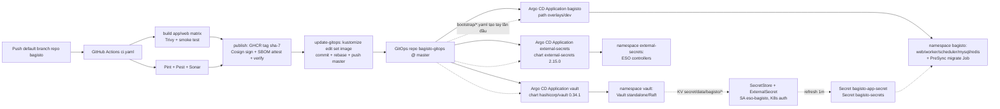

# Đánh giá hiện trạng — Giai đoạn 1 (chỉ đọc)

- Ngày khảo sát: 2026-11-23. Phạm vi: 2 repo `bagisto` và `bagisto-gitops` trong `/home/cuonglv2005/DevopsPractice`.
- Phương pháp: đọc file, `git log/status/ls-files`, `kubectl kustomize`, `helm show values`. Không sửa file, không apply/upgrade, không đọc giá trị secret/token/unseal key.
- Cluster Minikube hiện **không kết nối được** từ môi trường này (`kubectl version` client OK, server `192.168.49.2:8443` timeout/no route). Mọi kết luận về trạng thái cluster chỉ dựa trên manifest/docs; phần cluster thực tế để ở mục 7.
- File ghi duy nhất của giai đoạn này là `docs/assessment.md` (file này).

## 1. Tóm tắt hiện trạng (tối đa 10 dòng)

1. GitOps dùng Argo CD + Kustomize; cấu trúc chuẩn theo ADR 0001: `base/`, `overlays/dev/`, `platform/{vault,external-secrets}`, `bootstrap/`, `docs/`.
2. CI source repo build 2 image (`bagisto-app`, `bagisto-web`), tag `sha-<7>`, quét Trivy, test Pint/Pest/Sonar, ký Cosign keyless, attest SBOM, push GHCR.
3. Bot CI cập nhật tag image trong `overlays/dev/kustomization.yaml` rồi **push thẳng `master`**; Argo CD tự poll và sync, chưa qua PR/required check.
4. Vault: chart `0.34.1`, image `2.0.4`, standalone 1 replica, Raft + PVC `1Gi`, không HA, không TLS, UI bật, injector/CSI tắt, unseal tay.
5. ESO: chart `2.15.0`, namespace `external-secrets`; `SecretStore` + 2 `ExternalSecret` trong namespace `bagisto`, refresh `1m`, Vault Kubernetes auth role `bagisto`.
6. CI **không** xác thực Vault; `GITOPS_TOKEN` là GitHub token. Vault chỉ được xác thực bởi ESO (Kubernetes auth) và bởi script bootstrap dùng `VAULT_TOKEN` truyền tay.
7. Workload: `web` (php-fpm+nginx), `worker`, `scheduler`, `mysql` StatefulSet, `redis`, migration `PreSync` Job; mỗi thành phần 1 replica; không Ingress/TLS, port-forward.
8. Chưa có manifest nào cho Prometheus/Grafana/Alertmanager/Loki/ServiceMonitor/PrometheusRule/NetworkPolicy/Kyverno/Falco/OPA/PodSecurity trong cả 2 repo.
9. App log ra stderr qua `LOG_CHANNEL=stderr` nhưng chưa cấu formatter JSON; không tìm thấy route `/metrics` hay dependency Prometheus trong app.
10. Đã có guard CI: gitleaks full history, kubeconform, chặn `kind: Secret`/tag `latest`/placeholder `REPLACE`; Trivy config và source scan vẫn chỉ báo cáo.

## 2. Sơ đồ luồng CI/CD → GitOps → Cluster



Ghi chú: `bootstrap/*.yaml` nằm ngoài path `overlays/dev` nên không được Application `bagisto` tự quản lý; phải apply tay theo thứ tự AppProject → Application (`bootstrap/README.md:14-30`, `docs/architecture.md:92-99`).

## 3. Bảng thành phần đã có / chưa có

| Nhóm | Thành phần | Hiện trạng | Bằng chứng |
|---|---|---|---|
| Monitoring | Prometheus / Prometheus Operator | Chưa có trong repo | `grep` toàn repo GitOps chỉ thấy 1 match về log; không có CRD/values ServiceMonitor |
| Monitoring | Grafana | Chưa có | Không có values/dashboard/datasource |
| Monitoring | Alertmanager + kênh alert chung | Chưa có | Không có route/receiver; Argo CD notifications controller có cài theo doc nhưng chưa cấu hình (`bagisto/docs/argocd-setup.md:61`) |
| Monitoring | ServiceMonitor / PrometheusRule | Chưa có | `platform/vault/values.yaml`, `platform/external-secrets/values.yaml` không bật; ESO chart mặc định `serviceMonitor.enabled: false` |
| Monitoring | kube-state-metrics / node-exporter | Chưa có trong repo | Không có manifest |
| Logging | Loki / Promtail / Alloy | Chưa có | Chỉ có định hướng ghi log stderr (`base/configmap.yaml:27`) |
| Logging | Log app | Có một phần | `LOG_CHANNEL=stderr` (`base/configmap.yaml:27`), channel `stderr` dùng Monolog StreamHandler, formatter lấy từ `LOG_STDERR_FORMATTER` nhưng chưa set → plain text (`bagisto/config/logging.php:105-114`) |
| Logging | Log nginx/mysql/redis/Vault/ESO/Argo CD | Có log stdout/stderr, chưa tập trung | `Dockerfile.nginx`, `base/mysql.yaml`, `base/redis.yaml`, `platform/vault/values.yaml` |
| Security | Kyverno / OPA / Gatekeeper | Chưa có | Không có manifest/values |
| Security | Falco / Falco Sidekick | Chưa có | Không có manifest/values |
| Security | PodSecurity admission | Chưa có cấu hình trong repo | `base/*.yaml` chỉ có `allowPrivilegeEscalation: false`, `fsGroup`; không có `runAsNonRoot`/`readOnlyRootFilesystem` |
| Security | NetworkPolicy | Chưa có | Không có file nào trong 2 repo |
| Security | Quét CI | Có | Trivy image/source/config, gitleaks (`bagisto/.github/workflows/ci.yaml:53-76,118-133`; `bagisto-gitops/.github/workflows/ci.yml:228-304`) |
| Security | Ký image / SBOM | Có | Cosign keyless sign, attest CycloneDX, verify (`bagisto/.github/workflows/ci.yaml:295-345`) |
| Security | Verify chữ ký lúc deploy | Chưa có | Argo CD/Kustomize không verify Cosign (`bagisto/docs/argocd-setup.md:323`) |
| Secret | Vault + ESO | Có | `platform/vault/`, `platform/external-secrets/`, `base/eso-vault.yaml`, `bootstrap/application-*.yaml` |
| Secret | Vault telemetry / audit log | Chưa bật trong values | `server.auditStorage.enabled: false`, không có stanza `telemetry` (`platform/vault/values.yaml:61-90`) |

## 4. Danh sách rủi ro (xếp theo mức độ)

### Cao

| ID | Rủi ro | Đường dẫn |
|---|---|---|
| C1 | Không có monitoring/alert: Vault sealed, uninitialized, ESO sync lỗi, pod crash, Argo CD Degraded đều chỉ nhận ra bằng tay. Đặc biệt readiness Vault trả `204` khi sealed nên pod vẫn `Ready`, Application không Degraded → failure mode im lặng. | `platform/vault/values.yaml:76-87`; `base/eso-vault.yaml:35,58`; `docs/runbooks/vault-unseal.md:20` |
| C2 | Vault standalone 1 replica, Raft PVC `ReadWriteOnce`, không HA, không auto-unseal; mất PVC = mất toàn bộ secret, restart phải unseal tay. | `platform/vault/values.yaml:31-59`; `docs/architecture.md:121` |
| C4 | Không có NetworkPolicy: mọi pod trong `bagisto` (app, worker, mysql, redis) và các namespace platform có thể nói chuyện tự do. Lưu ý CNI hiện tại là **kindnet** (`bagisto/docs/argocd-setup.md:35`), không enforce NetworkPolicy — cần đổi sang CNI hỗ trợ policy (Cilium/Calico) trước khi tin vào bất kỳ NetworkPolicy nào. | `base/*.yaml`; `bagisto/docs/argocd-setup.md:35` |
| C5 | Deploy không dùng digest và không verify Cosign dù CI đã có cả hai. Overlay chỉ pin tag `sha-<7>`; tag mutable nếu bị ghi đè trên registry. | `overlays/dev/kustomization.yaml:12-16`; `bagisto/.github/workflows/ci.yaml:279-293,320-345`; `bagisto/docs/argocd-setup.md:323` |
| C6 | Bot push trực tiếp `master`, Argo CD sync ngay khi thấy commit; GitOps CI chạy sau commit nên rollback/validation bị động. ADR đã quyết định chuyển sang PR nhưng chưa áp dụng. | `bagisto/.github/workflows/ci.yaml:592-633`; `bootstrap/application.yaml:22-29`; `docs/adr/0001-repo-layout-and-conventions.md:56-58`; `bagisto/docs/argocd-setup.md:320` |

### Trung bình

| ID | Rủi ro | Đường dẫn |
|---|---|---|
| C3 | `ExternalSecret` dùng `deletionPolicy: Retain` (cố ý để không xóa Secret khi provider lỗi). Nguyên nhân rủi ro không phải là Vault sealed — đã có alert riêng cho sync failure — mà là localStorage có thể giữ credential cũ khi path trong Vault bị xóa/đổi hoặc khi ngừng sync; không có cơ chế rotate/revoke tự động. | `base/eso-vault.yaml:39-45,61-67` |
| C7 | Vault giao tiếp HTTP plaintext (`tlsDisable: true`) nhưng UI đã bật; ở dev chỉ nội bộ cluster nên chấp nhận được, nhưng nếu expose Service/Ingress ra ngoài sẽ lộ traffic quản trị. | `platform/vault/values.yaml:7-9,20-21,36-40` |
| T1 | Bootstrap Vault dùng biến môi trường `VAULT_TOKEN` truyền qua `kubectl exec` (thường là root token khi init); chưa tách token giới hạn cho việc cấu hình auth/policy. Không có giá trị nào được đọc hay ghi lại ở đây. | `platform/vault/bootstrap.sh:4,10`; `docs/runbooks/vault-unseal.md:7-9` |
| T2 | Thiếu CPU limit ở hầu hết workload (chỉ có memory limit); worker/scheduler/redis không có probes; web chỉ TCP probe; Vault `livenessProbe.enabled: false`. | `base/web.yaml:52-61,74-83`; `base/worker.yaml:38-40`; `base/scheduler.yaml:37-39`; `base/redis.yaml:46-54`; `platform/vault/values.yaml:89-90` |
| T3 | Container nginx master chạy root để bind `:80` và ghi cấu hình vào `/etc/nginx/conf.d` lúc start → sẽ là nguồn false positive lớn cho Falco/Kyverno. | `bagisto/Dockerfile.nginx:34-72,76-77` |
| T4 | Log chưa có formatter JSON; Loki sau này chỉ grep text được, khó query theo field. | `base/configmap.yaml:27`; `bagisto/config/logging.php:105-114` |
| T5 | App không expose `/metrics`; baseline chỉ có thể dùng kube-state-metrics/cAdvisor/blackbox cho đến khi thêm exporter hoặc endpoint. | Không có route metrics trong `bagisto/routes/`; không có dependency Prometheus trong `bagisto/composer.json` |
| T6 | CI repo source dùng action tag động (`@v4`, `@v3`...) trong khi GitOps CI pin SHA → rủi ro supply chain không đồng nhất. | `bagisto/.github/workflows/ci.yaml:30-37,55-76,112-125,255-261`; so sánh `bagisto-gitops/.github/workflows/ci.yml:47-48` |
| T7 | Trivy config & source scan vẫn `exit-code: 0`; image scan báo cáo CRITICAL/HIGH không chặn, chỉ CRITICAL chưa fix được chặn. | `bagisto-gitops/.github/workflows/ci.yml:228-270`; `bagisto/.github/workflows/ci.yaml:53-76,124-133` |
| T8 | Tài liệu kiến trúc/README cũ: vẫn hướng dẫn tạo Secret tay, trong khi code đã chuyển sang ESO. Dễ dẫn tới thao tác drift khi vận hành. | `README.md:20-42`; `docs/architecture.md:112-130`; so sánh `base/eso-vault.yaml:1-68` |
| T9 | Redis không persistent (`--save '' --appendonly no`) và PVC `uploads` RWO dùng chung cho web+worker+Job; mất Redis = mất queue/session, multi-node sẽ kẹt volume. | `base/redis.yaml:6-7,37`; `base/uploads-pvc.yaml:7,14`; `docs/architecture.md:114` |
| T10 | Nhãn chuẩn của ADR 0001 (`owner`, `env`, `managed-by`) chưa áp dụng → policy Kyverno đầu tiên sẽ báo rất nhiều violation ở chế độ Audit. | `docs/adr/0001-repo-layout-and-conventions.md:35-54`; `base/*.yaml` |
| T11 | Argo CD expose qua ClusterIP + self-signed, chưa SSO/RBAC theo nhóm; notifications controller chưa cấu hình. | `bagisto/docs/argocd-setup.md:91-101,293-320` |

### Thấp

| ID | Rủi ro | Đường dẫn |
|---|---|---|
| L1 | Ảnh app/web pin tag `sha-<7>` thay vì `@sha256:` dù CI đã xuất digest. | `overlays/dev/kustomization.yaml:12-16` |
| L2 | `.env` tồn tại locally trong repo app nhưng đã được gitignore; đã kiểm tra `git ls-files` → **không** được track. Cần tiếp tục đảm bảo không commit. | `bagisto/.gitignore:5`; `bagisto/.env` (không đọc nội dung) |
| L3 | `CODEOWNERS` trỏ tới `/config/` và `/apps/` không tồn tại trong bố cục hiện tại. | `.github/CODEOWNERS:3-6`; `docs/adr/0001-repo-layout-and-conventions.md:14-33` |
| L4 | Cluster unreachable nên chưa xác minh resource thực tế, CRD, chart đã cài, poll interval của Argo CD, branch protection. | `kubectl version` (server timeout); `docs/architecture.md:124-131` |
| L5 | Secret CI dùng cho DB test trong job `test` (chỉ DB tạm của runner); không phải secret production nhưng nên tiếp tục tách biệt rõ. | `bagisto/.github/workflows/ci.yaml:157-169` |

Không phát hiện Secret object, unseal key hay token bị hardcode trong file được track của 2 repo. Các phần có vẻ nhạy cảm trong log CI ở trên chỉ là tên biến/tham chiếu, không có giá trị được trích dẫn lại trong tài liệu này.

## 5. Đề xuất kế hoạch Monitoring baseline

### 5.1 Vị trí trong cấu trúc GitOps (giữ nguyên ADR 0001)

```
base/                       (giữ nguyên, Bagisto)
overlays/dev/               (giữ nguyên, bot vẫn sửa file này)
platform/
  vault/                    (bổ sung telemetry/audit + values)
  external-secrets/         (bật ServiceMonitor)
  monitoring/values.yaml    (MỚI: kube-prometheus-stack)
  logging/values.yaml       (MỚI: Loki + Promtail/Alloy)
bootstrap/
  appproject-observability.yaml  (MỚI)
  application-monitoring.yaml    (MỚI)
  application-loki.yaml          (MỚI)
  appproject-platform.yaml       (chỉ sửa nếu tái dùng project platform)
docs/assessment.md          (file này)
```

- Không chuyển sang `apps/...`; không đổi `GITOPS_OVERLAY_DIR` hay path của Application `bagisto`.
- Chart đề xuất: `prometheus-community/kube-prometheus-stack` (Prometheus Operator + Prometheus + Alertmanager + Grafana + kube-state-metrics + node-exporter) trong namespace **`monitoring`**; `grafana/loki` (hoặc `grafana/loki-stack` nếu muốn gồm Promtail) trong namespace **`logging`**. Pin cả chart version và image digest; thêm repo Helm tương ứng vào `sourceRepos` của AppProject.
- AppProject: tạo `appproject-observability.yaml` riêng thay vì mở rộng `platform`, giới hạn destination `monitoring`/`logging`, whitelist `monitoring.coreos.com/ServiceMonitor`, `monitoring.coreos.com/PrometheusRule`, `monitoring.coreos.com/AlertmanagerConfig` (nếu dùng), `Secret`, `ConfigMap`, `Service`, `ServiceAccount`, `Deployment`, `StatefulSet`, `DaemonSet`, `Role`, `RoleBinding`, CRD/ClusterRole nếu chart cần. `platform` vẫn giữ nguyên phạm vi Vault/ESO.
- ESO chart mặc định `serviceMonitor.enabled: false` (đã kiểm tra `helm show values ... --version 2.15.0`); bật trong `platform/external-secrets/values.yaml`. Dùng `renderMode: skipIfMissing` để không fail nếu Prometheus Operator CRD chưa sẵn sàng.
- Sensitive config: Slack webhook và Grafana admin password lưu trong Vault KV (ví dụ path `monitoring/alertmanager`, `monitoring/grafana`), đẩy sang Secret qua `ExternalSecret` + `ClusterSecretStore` (hoặc nhân bản `SecretStore` sang namespace `monitoring`). Không đưa giá trị vào `values.yaml`, không hardcode URL. Cấp cho SA của ESO policy chỉ đọc đúng các path đó.
- Verification/rollback ở Giai đoạn 2: `helm template` → `argocd app diff <app>` → `kubectl -n monitoring get pods,servicemonitor,prometheusrule` → PromQL như dưới đây; rollback bằng `git revert` commit tương ứng, để Argo CD self-heal (không `kubectl patch/edit`).

### 5.2 Vault cần bổ sung gì

1. Trong `platform/vault/values.yaml`: thêm stanza `telemetry { prometheus_retention_time = "24h" ... }` vào `standalone.config`; cân nhắc bật audit device (file/stdout) vì hiện `auditStorage.enabled: false`. Nếu bật audit file thì cần PVC riêng và policy retention.
2. Tạo `ServiceMonitor` chọn Service `vault` port `8200`, path `/v1/sys/metrics?format=prometheus`, `bearerTokenSecret` trỏ tới Secret do ESO tạo từ một Vault token chỉ có `read sys/metrics`. Không dùng root token.
3. Alert sealed/uninit **không cần token**: dùng blackbox exporter probe `/v1/sys/health?standbyok=true&sealedcode=503&uninitcode=503`, hoặc metric `vault_core_unsealed == 0` nếu scraping metrics thành công. Đây là alert ưu tiên số 1 vì readiness hiện tại che giấu trạng thái sealed.
4. Alert bổ sung: `up{job="vault"} == 0`; tăng `vault_audit_log_request_failure` / log có từ khóa audit failure (sau khi bật audit); PVC `data-vault-0` sắp đầy (`kubelet_volume_stats_used_bytes / kubelet_volume_stats_capacity_bytes > 0.85`).
5. Gợi ý PromQL tham khảo (đối chiếu tên metric với `/metrics` thực tế trước khi commit rule):
   ```promql
   probe_success{job="vault-health"} == 0
   vault_core_unsealed == 0
   up{job="vault"} == 0
   ```

### 5.3 ESO cần bổ sung gì

1. Bật ServiceMonitor cho controller ESO qua `platform/external-secrets/values.yaml` (`serviceMonitor.enabled: true`, namespace `monitoring`). Endpoint mặc định `:8080/metrics`; nếu bật TLS/RBAC auth cho metrics thì cấu hình thêm `bearerTokenSecret`/TLS config (hiện mặc định tắt).
2. Alert rule tối thiểu:
   - `ExternalSecretReadyFalse`: `externalsecret_status_condition{condition="Ready",status!="True"} == 1` trong 5 phút (đây là dấu hiệu sync lỗi rõ nhất).
   - `ExternalSecretSyncError`: `increase(externalsecret_sync_calls_error_total[15m]) > 0`.
   - `ExternalSecretStale`: thời gian từ lần sync thành công cuối vượt quá `2 * refreshInterval` (hiện `1m` → ngưỡng ~5 phút). Dùng metric `externalsecret_next_sync_time_seconds`/timestamp tương đương nếu có, hoặc `status.lastSuccessfulTime` qua kube-state-metrics/custom exporter nếu không có metric.
   - `ExternalSecretLatencyHigh`: `histogram_quantile(0.95, rate(externalsecret_sync_calls_duration_seconds_bucket[10m])) > 5` (nếu chart có histogram; nếu không, dùng độ trễ giữa `status.lastSuccessfulTime` và thời điểm poll).
   - `SecretStoreReadyFalse`: tương tự cho `secretstore_status_condition{condition="Ready",status!="True"} == 1`.
3. Vì `deletionPolicy: Retain`, phải alert riêng khi ExternalSecret không Ready thay vì chỉ dựa vào sự tồn tại của Secret.
4. Gợi ý PromQL:
   ```promql
   externalsecret_status_condition{condition="Ready",status!="True"} == 1
   increase(externalsecret_sync_calls_error_total[15m]) > 0
   ```

### 5.4 Ứng dụng, log và kênh alert

- App metrics: chưa có `/metrics`; baseline dùng blackbox exporter probe `http://web.bagisto.svc/` (kỳ vọng 302) + kube-state-metrics + cAdvisor thay vì sửa code. Nếu sau này thêm endpoint metrics, đặt ServiceMonitor riêng với selector nhãn `app.kubernetes.io/name=web`.
- Nguồn log cho Loki: stdout/stderr của `web/app`, `web/nginx`, `worker`, `scheduler`, `mysql`, `redis`, `vault`, ESO controllers, Argo CD; plus log kubelet/containerd qua Promtail/Alloy DaemonSet. Bắt đầu với label tối thiểu `namespace`, `pod`, `container`, `app.kubernetes.io/name`; thêm parser JSON sau khi set `LOG_STDERR_FORMATTER` cho Monolog.
- Kênh alert chung: 1 Alertmanager route/receiver Slack (hoặc email nếu chưa có Slack), receiver lấy webhook từ Secret do ESO/Vault tạo; `group_by: [alertname, namespace]`, `group_wait: 30s`, `group_interval: 5m`, `repeat_interval: 12h`. Grafana datasource Prometheus (`http://prometheus-operated.monitoring.svc:9090`) và Loki (`http://loki.logging.svc:3100`) khai báo trong values/datasource do Argo CD quản lý.
- Retention dev: Prometheus ~7 ngày, Loki ~72h, PVC size vừa phải cho Minikube 4 CPU/6 GB (cần xác nhận ở mục 7).

## 6. Phác thảo ngắn Kyverno và Falco + Sidekick (chỉ lập kế hoạch, không triển khai lượt này)

### Kyverno (Audit trước)

- Đặt chart trong namespace `kyverno` qua `bootstrap/application-kyverno.yaml` + `platform/kyverno/values.yaml`; `validationFailureAction: Audit` ở tất cả policy, chưa bật `Enforce`, chưa bật cleanup/generate policies.
- Policy nên có trước: (1) require labels `owner/env/app.kubernetes.io/managed-by` theo ADR; (2) require CPU+memory requests/limits; (3) require readiness/liveness probe; (4) disallow `:latest` và image không tag/digest; (5) disallow privileged & `allowPrivilegeEscalation: true`; (6) require `runAsNonRoot`/`readOnlyRootFilesystem` (Audit); (7) `verifyImages` Cosign keyless (Audit) để tận dụng chữ ký CI.
- Audit allowlist ban đầu cho `kube-system`, `argocd`, `vault`, `external-secrets`, `monitoring`, `logging` để tránh ngập policy report từ system component. Sau 1–2 sprint mới siết dần.
- Nguồn false positive đã biết: nginx root + ghi `/etc/nginx/conf.d` (`Dockerfile.nginx:34-77`), worker/scheduler/redis thiếu probes (T2), Vault liveness tắt, nhãn ADR chưa gắn (T10), Secret do ESO tạo tự động (không nên chặn), webhook `caBundle` nếu bật injector sau này.

### Falco + Falco Sidekick

- Deploy Falco (driver eBPF nếu kernel Minikube hỗ trợ; cần kiểm tra) trong namespace `security` qua Application riêng; bật output tới Falcosidekick cùng namespace.
- Sidekick outputs: Alertmanager (generic webhook) để vào kênh chung, Loki HTTP push để correlation log, Slack webhook lấy từ Vault/ESO; bật rate limiting/gzip.
- Rules bổ sung cần thiết cho cluster này, nhưng phải tune allowlist trước khi Enforce: `kubectl exec` vào `vault-0` cho init/unseal (`docs/runbooks/vault-unseal.md`), shell/`sh -c` trong mysql probe và redis command (`base/mysql.yaml:90-116`, `base/redis.yaml:37`), nginx ghi cấu hình lúc start, ESO/Vault controller tạo Secret, Argo CD repo-server chạy git/kustomize/helm.
- Bắt đầu ở chế độ "alert-only": không dùng Falco để kill pod; ghi vào Alertmanager+Loki, quan sát 1–2 tuần, sau đó mới thêm response tùy môi trường. Không triển khai trong lượt này.

## 7. Câu hỏi cần xác nhận

1. Chấp nhận namespace tách `monitoring` và `logging`, hay muốn gom thành một namespace `observability`?
2. Chọn version cụ thể nào cho kube-prometheus-stack / Loki / Falco / Kyverno, và có yêu cầu pin image digest luôn không? (Cluster Minikube v1.37.0, tài nguyên 4 CPU/6 GB theo README.)
3. Webhook Slack và Grafana admin password đã tồn tại trong Vault KV chưa? Nếu rồi, xin cho biết **path** (không gửi giá trị) để tạo ExternalSecret/ClusterSecretStore tương ứng. Nếu chưa, ai sẽ tạo?
4. Có cho phép tạo `ClusterSecretStore` dùng chung cho `monitoring`/`logging`, hay prefer nhân bản `SecretStore` trong từng namespace như hiện tại?
5. Có bật Vault audit device không (file trên PVC riêng hay stdout)? Có chấp nhận bật TLS cho Vault trong dev không, hay giữ HTTP do chỉ nội bộ cluster?
6. Có muốn scrape `/metrics` thật của Bagisto (phải sửa app/image, thêm dependency/PromQL endpoints) hay baseline này chỉ dùng blackbox + kube-state-metrics?
7. Tạo AppProject `observability` riêng hay mở rộng AppProject `platform` hiện tại? (Khuyến nghị: riêng.)
8. Cluster Minikube có sẽ được bật lên ở Giai đoạn 2 không? Hiện `kubectl` không kết nối được, nên mọi kiểm chứng thực tế đều chưa làm được.
9. Có bật required status check + branch protection + chuyển bot sang PR trước khi làm Giai đoạn 2 không, hay giữ luồng push thẳng `master` như hiện tại?
10. Chính sách retention Log/Metrics và kích thước PVC cho dev là bao nhiêu? Có cần lưu dashboard Grafana trong Git (JSON dưới `platform/monitoring/dashboards/`) không?
11. Có muốn đưa cả cảnh báo Argo CD sync failure/health Degraded vào cùng kênh Alertmanager (dùng notifications controller có sẵn) trong baseline này không?
12. Có required check tên job nào trong CI GitOps/source cần giữ nguyên khi thêm bước validate mới? (ADR 0001 yêu cầu không đổi tên job hiện có.)
